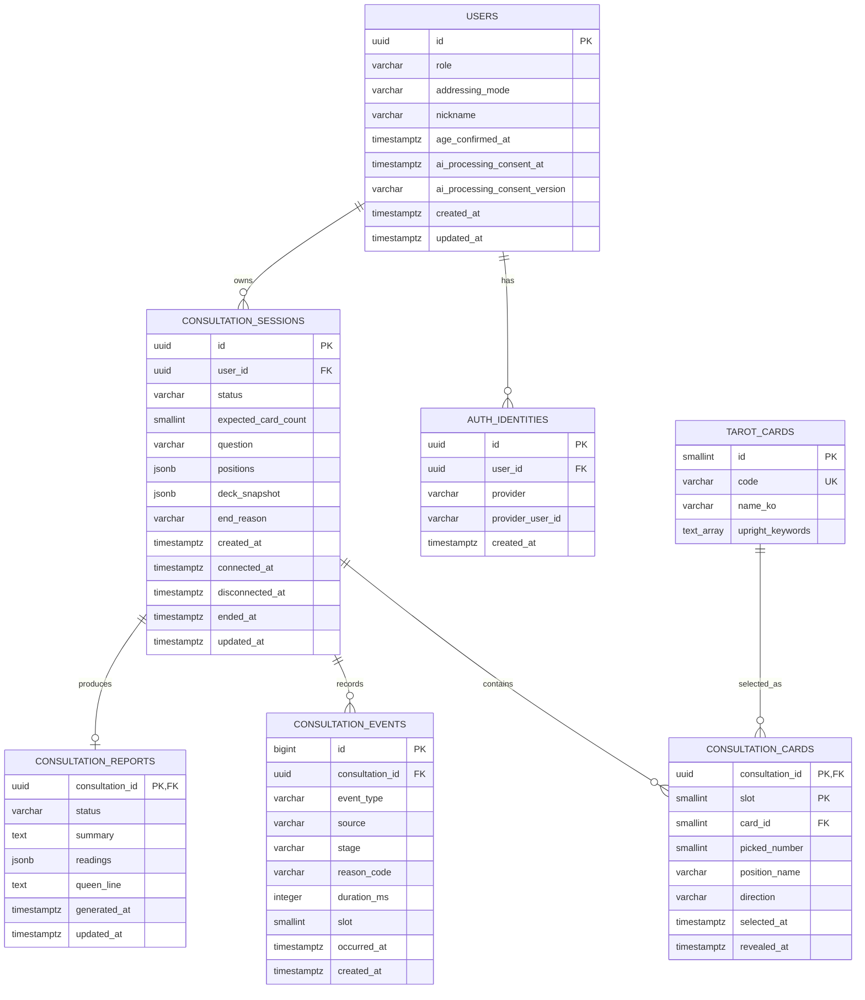

# 데이터베이스 설계

> 상위 문서: [백엔드 설계 문서 안내](./README.md)
> 기준일: 2026-11-12
> 미확정 사항은 **TBD**로 표시한다.

## 목차

- [DB 작성 규칙](#db-작성-규칙)
- [6. MVP DB 스키마](#6-mvp-db-스키마)
  - [6.0 컬럼 표 읽는 법](#60-컬럼-표-읽는-법)
    - [공통 컬럼](#공통-컬럼)
  - [6.1 ERD](#61-erd)
  - [6.2 테이블 명세](#62-테이블-명세)
    - [`users`](#users)
    - [`auth_identities`](#auth_identities)
    - [`tarot_cards`](#tarot_cards)
    - [`consultation_sessions`](#consultation_sessions)
    - [`consultation_cards`](#consultation_cards)
    - [`consultation_reports`](#consultation_reports)
    - [`consultation_events`](#consultation_events)
- [7. 후속 migration 후보](#7-후속-migration-후보)

## DB 작성 규칙

- 컬럼 타입은 **PostgreSQL 물리 스키마 타입**으로 표기한다. FastAPI/Python 타입과 REST JSON 타입은 아래 "컬럼 표 읽는 법"에서 비교한다.
- MVP 스키마에는 REST 응답, 권한 검사, 상태 복구, 최소 UX 모니터링에 필요한 값만 넣는다.
- **필수**는 행이 생성될 때 값이 반드시 있어야 하는 컬럼이다.
- **선택**은 특정 상태에서만 값이 생기는 컬럼이며, 값이 필요한 조건을 각 행에 적는다.
- 사용처가 정해지지 않은 컬럼은 추가하지 않는다.
- 후속 컬럼은 아래 조건이 실제로 생겼을 때 migration으로 추가한다.

## 6. MVP DB 스키마

### 6.0 컬럼 표 읽는 법

첫 번째 타입은 PostgreSQL 컬럼에 그대로 사용한다. FastAPI에서는 Python/Pydantic 타입으로 변환하고 REST API에서는 JSON으로 보낸다.

| 의미 | PostgreSQL 컬럼 타입 | FastAPI/Python 타입 | REST JSON 타입 | 사용 예시 |
|---|---|---|---|---|
| 고유 식별자 | `UUID` | `UUID` | `string` (`uuid`) | 사용자 ID, 상담 ID |
| 짧은 문자열, 코드 | `VARCHAR(n)` | `str` 또는 `Enum` | `string` | 상태, 역할, Provider, 카드 코드 |
| 길이가 긴 문자열 | `TEXT` | `str` | `string` | 리포트 요약, 카드별 해석 |
| 작은 범위의 정수 | `SMALLINT` | `int` | `integer` | 0~77 카드 ID, 1~78 선택 번호, 카드 순서 |
| 일반 정수, 소요 시간 | `INTEGER` | `int` | `integer` | 밀리초 단위 소요 시간 |
| 큰 범위의 순차 정수 | `BIGINT` | `int` | `integer` (`int64`) | 내부 상담 이벤트 ID |
| 문자열 목록 | `TEXT[]` | `list[str]` | `array<string>` | 카드 키워드 |
| 구조화된 배열, 객체 | `JSONB` | Pydantic 모델, `list` 또는 `dict` | `array` 또는 `object` | 덱 스냅샷, 카드별 리딩 |
| 시각 | `TIMESTAMPTZ` | `datetime` | `string` (`date-time`) | 생성, 연결, 종료 시각 |

예를 들어 DB의 `picked_number SMALLINT`는 FastAPI 코드에서 `int`, REST 요청에서는 JSON `integer`로 표현한다. `created_at TIMESTAMPTZ`는 FastAPI에서 `datetime`으로 다룬다.

#### 공통 컬럼

아래 컬럼명은 어느 테이블에서든 같은 뜻으로 사용한다. 단, 실제로 필요한 테이블에만 추가한다.

| 공통 컬럼 | PostgreSQL 타입 | 사용 방법 |
|---|---|---|
| `id` | `UUID` | 해당 엔터티의 내부 PK. API에 노출해도 순차 번호가 드러나지 않게 한다. `tarot_cards`처럼 범위가 고정된 기준 데이터는 `SMALLINT`, 외부 식별자로 사용하지 않는 추가 전용 이벤트는 `BIGINT IDENTITY`를 사용한다. |
| `{entity}_id` | `UUID` 또는 참조 대상 PK 타입 | 다른 테이블을 참조하는 FK. 예: `user_id`, `consultation_id`, `card_id` |
| `status` | `VARCHAR(n)` | 현재 처리 상태. 테이블별 허용값을 문서와 DB `CHECK` 제약조건으로 제한한다. |
| `created_at` | `TIMESTAMPTZ` | 행이 처음 생성된 시각. 특별한 이유가 없으면 `now()`를 기본값으로 사용한다. |
| `updated_at` | `TIMESTAMPTZ` | 행이 마지막으로 변경된 시각. 생성 시 `created_at`과 같은 값으로 시작하고 변경 트랜잭션에서 갱신한다. |
| `*_at` | `TIMESTAMPTZ` | 특정 사건이 발생한 시각. 예: `connected_at`, `selected_at`, `ended_at`. 아직 발생하지 않았으면 `NULL`을 허용한다. |

추가 공통 규칙은 다음과 같다.

- DB 시각 컬럼은 모두 `TIMESTAMPTZ`를 사용하고 애플리케이션과 REST API에서는 UTC로 읽고 쓴다.
- **필수** 컬럼은 원칙적으로 `NOT NULL`, **선택** 컬럼은 상태별 값 생성 전까지 `NULL`을 허용한다.
- 상태, 역할, Provider, 방향처럼 허용값이 정해진 문자열은 FastAPI의 `Enum`과 PostgreSQL `CHECK` 제약조건을 함께 사용한다.
- `created_at`, `updated_at` 같은 기술 컬럼과 사용자의 실제 행동 시각인 `selected_at`, `ended_at`을 구분한다.
- 삭제 시각인 `deleted_at`은 현재 MVP에 탈퇴, 소프트 삭제 정책이 없으므로 공통 컬럼으로 추가하지 않는다. 보존, 삭제 정책이 확정되면 별도 migration으로 검토한다.

### 6.1 ERD

### 6.2 테이블 명세

#### `users`

| 컬럼 | 타입 | 필수 여부 | 사용처/조건 |
|---|---|---|---|
| `id` | UUID | 필수 | 사용자, 상담 소유권을 확인하는 내부 PK |
| `role` | VARCHAR(16) | 필수 | 관리자 API 권한 검사에 사용. `USER`/`ADMIN`, default `USER` |
| `addressing_mode` | VARCHAR(16) | 선택 | 온보딩 완료 후 필수. `DEFAULT` 또는 `CUSTOM` |
| `nickname` | VARCHAR(20) | 선택 | `addressing_mode = CUSTOM`일 때만 필수 |
| `age_confirmed_at` | TIMESTAMPTZ | 선택 | 만 14세 확인을 완료하면 저장. 상담 생성 전에는 값이 있어야 함 |
| `ai_processing_consent_at` | TIMESTAMPTZ | 선택 | AI 처리 동의 완료 시 저장. 상담 생성 전에는 값이 있어야 함 |
| `ai_processing_consent_version` | VARCHAR(32) | 선택 | `ai_processing_consent_at`이 있으면 같은 요청에서 반드시 저장 |
| `created_at` | TIMESTAMPTZ | 필수 | 신규 사용자 수 집계 기준. default `now()` |
| `updated_at` | TIMESTAMPTZ | 필수 | 호칭, 동의 변경 시 갱신 |

상담 생성은 `addressing_mode`, `age_confirmed_at`, `ai_processing_consent_at`, `ai_processing_consent_version`이 모두 있을 때만 허용한다. `CUSTOM`이면 `nickname`도 있어야 한다.

#### `auth_identities`

| 컬럼 | 타입 | 필수 여부 | 사용처/조건 |
|---|---|---|---|
| `id` | UUID | 필수 | 인증 계정 PK |
| `user_id` | UUID | 필수 | 서비스 사용자 연결. FK `users.id` |
| `provider` | VARCHAR(16) | 필수 | 로그인 제공자. `KAKAO`/`NAVER`/`OPENAI` |
| `provider_user_id` | VARCHAR(255) | 필수 | 같은 Provider 계정의 재로그인 식별값 |
| `created_at` | TIMESTAMPTZ | 필수 | 계정 연결 생성 시각. default `now()` |

유니크 제약은 `(provider, provider_user_id)`다. 서로 다른 Provider의 이메일이 같아도 이 값으로 자동 병합하지 않는다.

#### `tarot_cards`

| 컬럼 | 타입 | 필수 여부 | 사용처/조건 |
|---|---|---|---|
| `id` | SMALLINT | 필수 | 카드 FK와 서버 덱 생성에 사용하는 0~77 PK |
| `code` | VARCHAR(64) | 필수 | 이름 변경과 무관한 고유 식별자 |
| `name_ko` | VARCHAR(64) | 필수 | 카드 선택, 리포트 화면에 표시 |
| `arcana` | VARCHAR(8) | 필수 | `MAJOR` 또는 `MINOR` |
| `suit` | VARCHAR(16) | 선택 | 마이너 카드의 `WANDS`, `CUPS`, `SWORDS`, `PENTACLES`. 메이저는 `NULL` |
| `rank` | VARCHAR(16) | 필수 | 메이저 번호 또는 마이너의 `ACE`, `2`~`10`, `PAGE`, `KNIGHT`, `QUEEN`, `KING` |
| `upright_keywords` | TEXT[] | 필수 | 정방향 카드 해석 컨텍스트 |

MVP는 고정된 78장만 사용하며 모든 행을 활성 카드로 취급한다. `code`는 메이저의
`major-00-fool`, 마이너의 `wands-ace`처럼 카드 분류와 rank가 드러나는 안정적인 값을
사용한다. 카드 이미지는 프론트엔드 정적 자산으로 관리하며, 프론트엔드는 API의 `code`를
이미지 파일과 매핑한다. 백엔드 DB에는 이미지 경로나 URL을 저장하지 않는다.

#### `consultation_sessions`

| 컬럼 | 타입 | 필수 여부 | 사용처/조건 |
|---|---|---|---|
| `id` | UUID | 필수 | 외부 API에 노출하는 상담 PK |
| `user_id` | UUID | 필수 | 상담 소유권 검사. FK `users.id` |
| `status` | VARCHAR(24) | 필수 | 생성, 연결, 중단, 종료 API의 상태 전이 검사 |
| `expected_card_count` | SMALLINT | 필수 | 상담 생성 시 서버가 확정한 카드 수. MVP default `3` |
| `question` | VARCHAR(500) | 선택 | 카드 선택을 확정할 때부터 필수 |
| `positions` | JSONB | 선택 | 카드 선택을 확정할 때부터 필수. 문자열 수가 `expected_card_count`와 같아야 함 |
| `deck_snapshot` | JSONB | 필수 | 상담 생성 시 고정한 78개 `{card_id}` 배열. 재시도에도 같은 카드 결과를 반환하기 위해 저장 |
| `end_reason` | VARCHAR(32) | 선택 | 상담이 `ENDED`가 될 때 필수 |
| `created_at` | TIMESTAMPTZ | 필수 | 상담 생성 시각과 목록 정렬 기준 |
| `connected_at` | TIMESTAMPTZ | 선택 | 최초 `REALTIME_CONNECTED` 이벤트 수신 시 저장 |
| `disconnected_at` | TIMESTAMPTZ | 선택 | 마지막 `REALTIME_DISCONNECTED` 이벤트 수신 시 저장 |
| `ended_at` | TIMESTAMPTZ | 선택 | 상담이 `ENDED`가 될 때 필수 |
| `updated_at` | TIMESTAMPTZ | 필수 | 상태, 질문, 종료 정보 변경 시 갱신 |

인덱스는 `(user_id, created_at DESC)`를 둔다. `deck_snapshot`은 API 응답에 포함하지 않는다.

#### `consultation_cards`

| 컬럼 | 타입 | 필수 여부 | 사용처/조건 |
|---|---|---|---|
| `consultation_id` | UUID | 필수 | 상담 FK이자 복합 PK |
| `slot` | SMALLINT | 필수 | 공개 순서. 1부터 `expected_card_count` 이하 |
| `card_id` | SMALLINT | 필수 | 선택된 카드 FK |
| `picked_number` | SMALLINT | 필수 | 사용자가 선택한 1~78 번호 |
| `position_name` | VARCHAR(100) | 필수 | 해당 카드가 해석할 자리 이름 |
| `direction` | VARCHAR(8) | 필수 | `UPRIGHT`. 기존 응답 계약 호환을 위해 유지 |
| `selected_at` | TIMESTAMPTZ | 필수 | 카드 선택 확정 시각 |
| `revealed_at` | TIMESTAMPTZ | 선택 | 해당 slot 공개 API가 성공하면 저장 |

복합 PK는 `(consultation_id, slot)`, 유니크 제약은 `(consultation_id, picked_number)`다. 카드 수와 slot 상한은 상담 행을 잠근 트랜잭션에서 검사한다.

#### `consultation_reports`

| 컬럼 | 타입 | 필수 여부 | 사용처/조건 |
|---|---|---|---|
| `consultation_id` | UUID | 필수 | 상담당 리포트 1개를 보장하는 PK/FK |
| `status` | VARCHAR(16) | 필수 | `PENDING`, `COMPLETED`, `FAILED` |
| `summary` | TEXT | 선택 | `COMPLETED`일 때 필수 |
| `readings` | JSONB | 선택 | `COMPLETED`일 때 필수. 공개된 slot별 `{slot, text}` 배열 |
| `queen_line` | TEXT | 선택 | `COMPLETED`일 때 필수 |
| `generated_at` | TIMESTAMPTZ | 선택 | `COMPLETED`일 때 필수 |
| `updated_at` | TIMESTAMPTZ | 필수 | 생성, 실패, 재시도 상태 변경 시 갱신 |

리포트의 질문과 카드 정보는 `consultation_sessions`와 `consultation_cards`에서 조회한다. 요청 본문의 카드 ID, 이름, 방향은 저장하지 않는다.

#### `consultation_events`

이 테이블에는 모든 API 요청을 저장하지 않는다. 단계별 이탈, 음성 연결 실패, 재연결, TTS 실패를 집계하는 데 필요한 이벤트만 저장한다. 오류 전문과 성능 로그는 Vercel Logs에 남긴다.

| 컬럼 | 타입 | 필수 여부 | 사용처/조건 |
|---|---|---|---|
| `id` | BIGINT | 필수 | 이벤트 내부 PK. `GENERATED ALWAYS AS IDENTITY` 사용 |
| `consultation_id` | UUID | 필수 | 상담별 흐름과 오류율 집계. FK `consultation_sessions.id` |
| `event_type` | VARCHAR(48) | 필수 | 허용된 이벤트 종류만 저장 |
| `source` | VARCHAR(16) | 필수 | 이벤트를 관측한 주체. `FE` 또는 `BE` |
| `stage` | VARCHAR(32) | 선택 | `FLOW_STAGE_ENTERED`일 때만 필수 |
| `reason_code` | VARCHAR(64) | 선택 | 연결 중단, 실패, 취소 원인을 사전 정의된 코드로만 저장 |
| `duration_ms` | INTEGER | 선택 | 연결, 합성 등 측정 대상의 0 이상 소요 시간 |
| `slot` | SMALLINT | 선택 | 카드 공개, 리딩 단계에서 필요한 경우에만 1부터 `expected_card_count` 이하 |
| `occurred_at` | TIMESTAMPTZ | 필수 | FE 또는 BE에서 사건이 실제 발생한 시각 |
| `created_at` | TIMESTAMPTZ | 필수 | 서버가 이벤트를 DB에 저장한 시각. default `now()` |

허용 `event_type`은 아래로 제한한다.

- `FLOW_STAGE_ENTERED`: `INTRO`, `CONNECTING`, `QUESTION`, `QUESTION_CONFIRM`, `NUMBER_SELECTION`, `SELECTION_CONFIRM`, `CARD_REVEAL`, `CARD_READING`, `SYNTHESIS`, `COMPLETED`
- `REALTIME_CONNECTION_FAILED`, `REALTIME_DISCONNECTED`
- `RECONNECT_ATTEMPTED`, `RECONNECT_SUCCEEDED`
- `TTS_FAILED`, `TTS_PLAYBACK_CANCELLED`
- `PAGE_HIDDEN`

상담 생성, 카드 선택, 카드 공개, 상담 종료, 리포트 상태는 기존 테이블에서 시각과 결과를 조회할 수 있으므로 이벤트로 중복 저장하지 않는다. 질문, 사용자 발화, transcript, TTS 문장, 리포트 본문, OAuth/API 비밀 값, 이메일, 전화번호도 저장하지 않는다. 임의 JSON을 담는 `metadata` 컬럼은 두지 않는다.

인덱스는 `(consultation_id, occurred_at)`, `(event_type, occurred_at)`를 둔다. 같은 쓰기 요청의 재시도는 `Idempotency-Key`로 같은 이벤트를 중복 생성하지 않게 한다. 이벤트 보존 기간과 삭제 주기는 운영 정책 확정 전까지 **TBD**다.

## 7. 후속 migration 후보

아래 컬럼은 MVP 첫 migration에서 제외한다. 표의 조건이 생기면 별도 migration으로 추가한다.

| 테이블, 컬럼 | 추가하는 경우 |
|---|---|
| `users.onboarding_completed_at` | 온보딩 완료 시각을 별도 퍼널 지표로 수집하기로 결정한 경우 |
| `users.last_login_at` | 사용자 단위 최근 로그인 조회 기능을 추가한 경우 |
| `users.display_name`, `profile_image_url` | 프로필 화면과 사용자 수정 정책을 확정하고 서비스 공통 프로필로 저장하기로 결정한 경우. 상담용 `nickname`과 분리한다. |
| `auth_identities.last_login_at` | Provider별 최근 로그인 시각을 운영 화면에 표시하는 경우 |
| `auth_identities.provider_email`, `provider_email_verified` | 이메일의 사용 목적과 Provider별 제공, 동의, 검증 범위를 확정하고 Provider별 스냅샷을 저장하기로 결정한 경우. 계정 자동 병합에는 사용하지 않는다. |
| `tarot_cards.deck_version` | 서로 다른 카드 데이터 버전을 동시에 운영하는 경우 |
| `tarot_cards.is_active` | 배포 없이 특정 카드를 제외하는 관리자 기능을 추가한 경우 |
| `consultation_sessions.scenario_code`, `scenario_version` | 두 개 이상의 상담 시나리오를 운영하거나 시나리오 규칙을 버전별로 복원해야 하는 경우 |
| `consultation_sessions.deck_version` | 기존 상담이 사용한 카드 이름, 키워드 버전을 그대로 재현해야 하는 경우 |
| `consultation_sessions.realtime_model` | 상담별 모델을 다르게 사용하거나 모델별 품질, 비용을 비교하는 경우 |
| `consultation_sessions.tts_provider`, `tts_model`, `tts_voice_id` | 상담마다 TTS 제공자, 모델, voice를 다르게 선택하는 경우 |
| `consultation_sessions.reconnect_expires_at` | 상담마다 서로 다른 재연결 만료 시각을 저장해야 하는 경우 |
| `consultation_reports.question_snapshot` | 리포트 생성 후에도 상담 질문을 수정할 수 있게 만드는 경우 |
| `consultation_reports.generation_source`, `generation_model` | 둘 이상의 리포트 생성 경로, 모델을 동시에 운영하고 결과를 비교하는 경우 |
