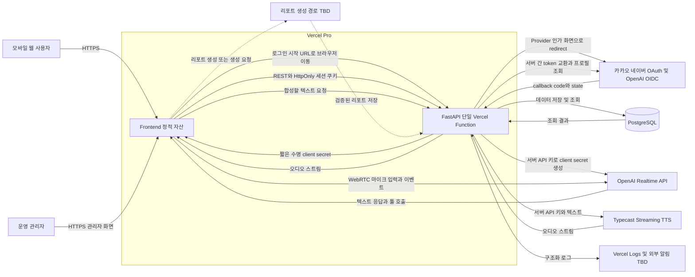
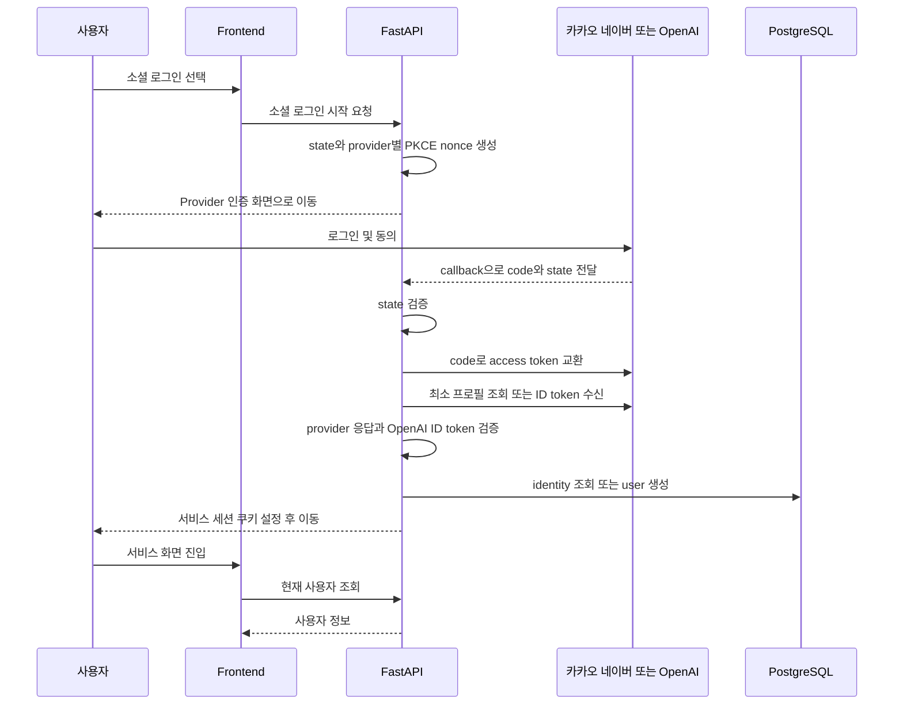

# 시스템 아키텍처와 사용자 관리

> 상위 문서: [백엔드 설계 문서 안내](./README.md)
> 기준일: 2026-11-12
> 미확정 사항은 **TBD**로 표시한다.

## 목차

- [아키텍처 원칙](#아키텍처-원칙)
- [4. 시스템 아키텍처](#4-시스템-아키텍처)
  - [4.1 컴포넌트별 처리 범위](#41-컴포넌트별-처리-범위)
  - [4.2 신뢰 경계와 서버 검증 원칙](#42-신뢰-경계와-서버-검증-원칙)
  - [4.3 Vercel의 역할](#43-vercel의-역할)
- [5. 사용자 관리](#5-사용자-관리)
  - [5.1 로그인 흐름](#51-로그인-흐름)
  - [5.2 저장할 사용자 정보](#52-저장할-사용자-정보)
  - [5.3 FE 협의 필요 항목](#53-fe-협의-필요-항목)

## 아키텍처 원칙

- 비밀 키를 브라우저에 노출하지 않는다.
- 사용자 음성 입력은 지연을 줄이기 위해 브라우저와 OpenAI가 직접 연결한다.
- MVP에서는 상시 실행 서버와 별도 음성 중계 계층을 두지 않는다.
- FastAPI는 인증과 권한을 검사하고 상담 데이터를 저장하며 Typecast 키를 보호한다.

## 4. 시스템 아키텍처

### 4.1 컴포넌트별 처리 범위

| 컴포넌트 | 책임 | 하지 않는 일 |
|---|---|---|
| Frontend | 마이크 입력, WebRTC 연결, Realtime 텍스트 수신, Typecast 요청 분할/재생/중단, 화면 상태와 자막, 카드 번호 입력 | OpenAI/Typecast 메인 키 보관, 카드 결과 결정 |
| FastAPI | 인증과 권한 검사, 상담 ID와 client secret 발급, 덱과 카드 확정, Typecast 스트리밍 프록시, 리포트와 최소 상담 이벤트 저장, 관리자 조회 API, 기술 로그 | 사용자 마이크 중계, OpenAI WebRTC 연결 유지, 음성 파일 저장 |
| PostgreSQL | 사용자, 상담, 카드, 리포트, 최소 UX 이벤트 저장 | 모든 API 요청 로그 저장, 실시간 연결 객체 보관 |
| OpenAI Realtime | 사용자 음성 이해, 텍스트 응답, 프롬프트, tool call | 최종 음성 합성, 서비스 사용자와 카드 데이터 저장 |
| Typecast | OpenAI 응답 텍스트의 스트리밍 음성 합성 | 상담 판단, 카드 상태 변경, 사용자 인증 |
| 카카오/네이버/OpenAI | 사용자 인증과 provider user ID 제공 | 서비스 세션 발급, Realtime 상담 권한 부여 |

### 4.2 신뢰 경계와 서버 검증 원칙

- 브라우저 요청은 모두 신뢰하지 않고 로그인 사용자와 상담 소유권을 다시 확인한다.
- 관리자 API는 일반 로그인과 별도로 `ADMIN` 역할을 검사하고, 모든 조회에 기간과 결과 개수 제한을 적용한다.
- 브라우저는 카드 ID나 방향을 보내지 않는다. `expected_card_count`만큼 1~78의 번호를 보내면 서버가 저장된 덱과 매핑한다. 카드 수는 서버의 시나리오 설정에서 읽는다.
- Realtime tool call 결과를 그대로 실행하지 않는다. 카드 선택이나 공개처럼 상태가 바뀌는 요청은 FastAPI가 사용자, 상담 상태, 입력값을 검증한 뒤 처리한다.
- OpenAI Realtime API 키, Typecast API 키, OpenAI 로그인 client ID/secret, 카카오 Client Secret, 네이버 Client Secret, DB URL은 Vercel 환경 변수로만 관리한다. OpenAI 로그인 credential과 Realtime API 키는 분리한다.
- Typecast 요청은 로그인 사용자가 소유한 활성 상담에서만 허용한다. 모델과 voice ID는 서버의 허용 목록에서 선택하고 상담별 글자 수와 호출 수를 제한한다. 구체적인 한도는 **TBD**다.
- Vercel 기술 로그와 PostgreSQL 상담 이벤트에는 OAuth 토큰, client secret, 원문 고민, transcript, TTS 문장, 리포트 본문을 기록하지 않는다.

### 4.3 Vercel의 역할

Vercel에서는 FE를 배포하고 FastAPI Function을 실행한다. AI 모델과 PostgreSQL은 별도 서비스에 둔다.

- FE 정적 자산 배포와 CDN 제공
- FastAPI를 단일 Vercel Function으로 실행
- Preview/Production 환경 분리와 환경 변수 보관
- OAuth callback, REST API, Realtime client secret 발급 처리
- Typecast API 키를 보호하면서 합성 오디오를 FE에 스트리밍
- 함수 로그와 기본 관측성 제공

PostgreSQL 제공사는 **TBD**다. OpenAI Realtime WebRTC 연결은 브라우저와 OpenAI 사이에서 유지되므로 Vercel이 통화 전체를 중계하지 않는다. Typecast 오디오만 짧은 HTTP 스트리밍 요청으로 FastAPI Function을 통과한다. Preview에서 지연 시간, 동시 요청, 비용을 측정한다.

## 5. 사용자 관리

### 5.1 로그인 흐름

카카오와 네이버는 Authorization Code 흐름을 사용한다. OpenAI 로그인은 공식 명칭인 “Sign in with ChatGPT”의 Authorization Code + PKCE + OpenID Connect 흐름을 사용하고 `state`, `nonce`, PKCE verifier, ID token의 서명, `iss`, `aud`, 만료를 검증한다. OpenAI의 `sub`를 `provider_user_id`로 저장한다.

OpenAI 로그인은 OpenAI Realtime API 사용 권한을 대신하지 않는다. 서비스는 로그인 제공자와 관계없이 서버의 OpenAI API 키로 Realtime client secret을 발급한다. OpenAI identity scope도 사용자의 ChatGPT 대화나 API 키 접근 권한을 주지 않는다.

현재 공식 문서상 웹사이트용 “Sign in with ChatGPT”는 제한된 상용 파트너 시험 기능이다. OAuth client를 발급받기 전에는 구현 대상으로 잡지 않는다. client 발급 가능 여부와 승인된 버튼 문구, 브랜딩은 **TBD**다. 무드보드의 “OpenAI로 시작하기”를 “ChatGPT로 계속하기” 등 공식 문구로 바꿀지는 FE와 확인한다.

MVP에서는 Provider access token과 OpenAI ID token을 검증한 뒤 폐기한다. 이후 Provider API를 호출해야 할 때만 저장 여부, 암호화, 폐기 방법을 다시 정한다.

### 5.2 저장할 사용자 정보

| 정보 | 저장 여부 | 목적 | 비고 |
|---|---|---|---|
| 서비스 사용자 UUID | 저장 | 내부 참조 키 | 외부에 순차 ID 노출 금지 |
| Provider 종류 | 저장 | 로그인 경로 식별 | `KAKAO`, `NAVER`, `OPENAI` |
| Provider user ID | 저장 | 동일 계정 재로그인 | provider별 unique |
| 서비스 호칭 | 저장 | 무드보드의 “편하게 불러줘/직접 입력” 반영 | Provider 이름과 분리, 직접 입력 규칙 **TBD** |
| 프로필 표시명, 이미지 | 저장 여부 **TBD** | 프로필 화면과 계정 식별 보조 | 서비스 호칭과 분리. Provider 제공값 사용 여부, 사용자 수정, 갱신, 삭제 정책 확인 후 결정 |
| 이메일 | 저장 여부 **TBD** | 고객지원, 알림, 계정 복구 등 확정된 용도가 있을 때만 사용 | Provider별 제공, 검증, 동의 범위와 저장 위치 확인 필요. 계정 자동 병합 기준으로 사용하지 않음 |
| 전화번호, 성별, 연령대 | 기본 미수집 | 현재 MVP 기능에 필요 없음 | 구체적인 기능과 동의 근거가 생긴 경우에만 별도 검토 |
| 만 14세 확인 시각 | 저장 | PoC 고지의 서버 이전 | 정확한 법무 요건 **TBD** |
| AI 처리 동의 시각, 버전 | 저장 | OpenAI로 사용자 음성, Typecast로 응답 텍스트 전송 동의 증빙 | 문구, 버전 **TBD** |
| Provider access/refresh token | MVP에서 저장하지 않음 | MVP 후속 API 없음 | 필요 시 **TBD** |

서비스 로그인은 `Secure`, `HttpOnly`, `SameSite=Lax` 쿠키를 기본 조건으로 한다. JWT/opaque ID, 만료 시간, 갱신 방식은 **TBD**다.

첫 로그인 후 FE는 기본 호칭과 직접 입력 중 하나를 받아 `PATCH /api/v1/users/me`로 저장한다. Provider가 준 이름이나 이메일은 서비스 호칭으로 자동 사용하지 않는다. 프로필 표시명, 이미지, 이메일은 화면과 사용 목적, Provider 동의 범위, 수정 및 삭제 정책을 정한 뒤 DB와 사용자 API에 추가한다. 서로 다른 Provider의 이메일이 같아도 계정을 자동 병합하지 않는다. 사용자가 직접 계정을 연결하는 기능이 생기기 전까지는 별도 사용자로 처리한다.

### 5.3 FE 협의 필요 항목

다음 항목은 FE 화면과 오류 처리 방식이 정해져야 백엔드 값도 확정할 수 있다.

| 협의 항목 | 백엔드 초안 | FE에서 정할 내용 |
|---|---|---|
| 로그인 제공자 | 카카오, 네이버 제공, OpenAI는 client 발급 전 **TBD** | 노출 순서, 미제공 시 화면, 공식 버튼 문구 |
| 로그인 완료, 실패 | callback 후 서비스 경로로 이동 | 성공, 취소, 오류별 이동 경로와 안내 |
| 온보딩 진입 | `onboarding_required`로 미완료 상태 전달 | 호칭, 필수 동의 화면 순서와 이탈 후 복귀 |
| 서비스 호칭 | `DEFAULT` 또는 `CUSTOM`, 직접 입력 규칙 **TBD** | 기본 문구, 입력 UX, 길이, 허용 문자 오류 표시 |
| 사용자 프로필 | 표시명, 이미지, 이메일 저장 여부 **TBD** | 프로필 화면 제공 여부, 표시, 수정 항목, 이메일 사용 목적과 Provider 정보 동기화 방식 |
| 필수 동의 | 동의 시각과 버전을 서버에 저장 | 문구 배치, 개별, 일괄 동의, 버전 변경 시 재동의 UX |
| 세션 만료 | 만료된 요청은 인증 오류 반환 | 재로그인 안내, 진행 중 상담 처리와 복귀 위치 |
| 계정 연결 | 같은 이메일이어도 자동 병합하지 않음 | 중복 계정 안내와 향후 명시적 연결 진입점 |
