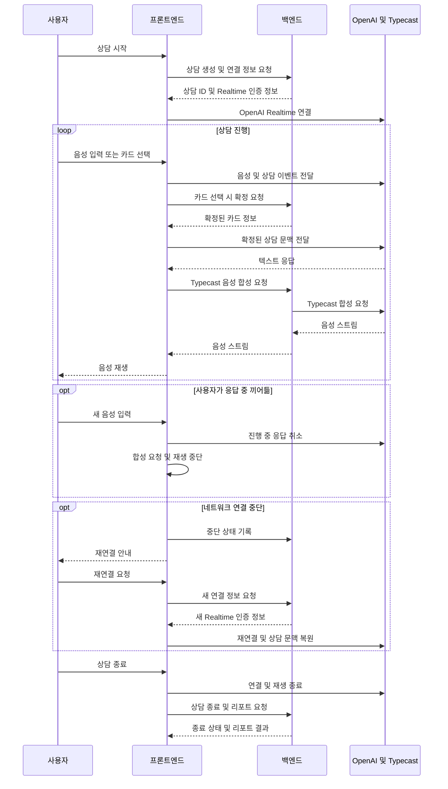
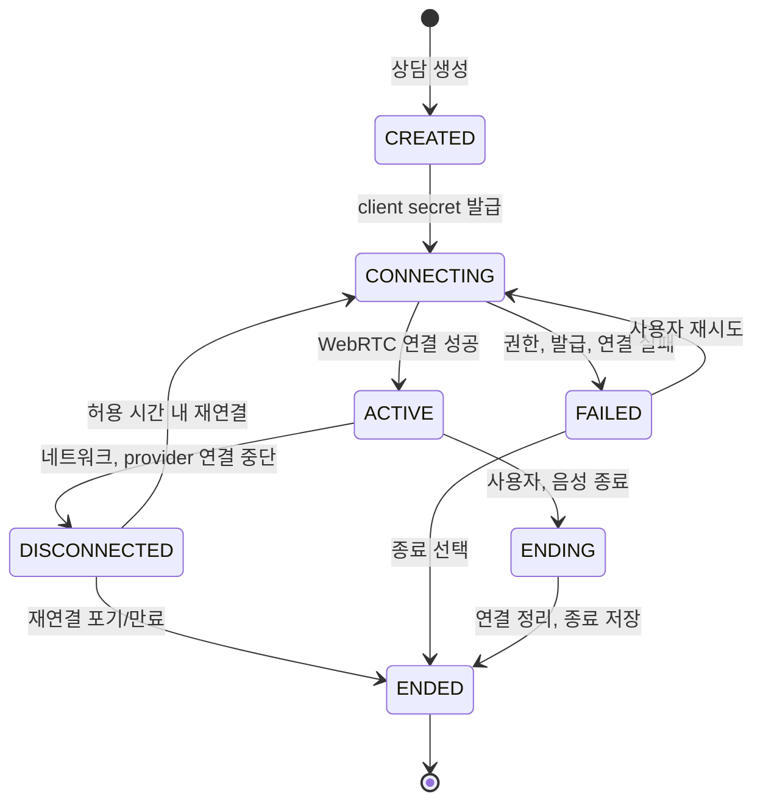

# 음성 상담 흐름

> 상위 문서: [백엔드 설계 문서 안내](./README.md)
> 기준일: 2026-11-12
> 미확정 사항은 **TBD**로 표시한다.

## 목차

- [참조 문서](#참조-문서)
- [8. 음성 상담 흐름](#8-음성-상담-흐름)
  - [8.1 정상 통화와 재연결 시퀀스](#81-정상-통화와-재연결-시퀀스)
  - [8.2 상담 상태 다이어그램](#82-상담-상태-다이어그램)
  - [8.3 오류 처리](#83-오류-처리)

## 참조 문서

사용자 흐름은 2026-11-12 컨셉안과 TEAM REVIEW를 따른다. 음성 연결, 카드, 리포트 동작은 같은 날짜의 Frontend 프로젝트 `tarot-voice`를 확인해 작성했다.

세부 동작은 다음 문서에 나뉘어 있다.

- 컴포넌트별 처리 범위와 서버 검증 규칙: [시스템 아키텍처](./system-architecture.md)
- 상담, 카드, 이벤트 API: [REST API 개요](./rest-api.md), [REST API 상세 명세](./rest-api-spec.md)
- DB에 저장되어 연결이 끊겨도 유지되는 상담 상태와 복구 데이터: [데이터베이스 설계](./database.md)
- 미확정 항목과 결정 시점: [TBD 목록](./decision-gates.md)

이 문서에는 백엔드가 처리할 음성 연결, 상담 상태 변경, 카드 확정과 공개, TTS 재생 중단, 재연결, 종료 순서를 적는다. 화면 대본과 FE 화면 전환은 다루지 않는다. REST API나 DB 스키마가 바뀌면 시퀀스와 오류 처리 표도 함께 수정한다.

## 8. 음성 상담 흐름

### 8.1 정상 통화와 재연결 시퀀스

이 시퀀스에는 정상 통화, 끼어들기, 재연결, 종료 순서만 표시한다. DB 상태 변경과 카드 공개 조건, 인증 정보, 이벤트 이름, 오류 코드는 아래 표와 REST API 상세 명세에서 확인한다.

Realtime instructions와 카드 관련 tool schema에는 상담에 저장된 `expected_card_count`와 `positions`를 전달한다. 고정값 3을 프롬프트나 FE 로직에 중복 하드코딩하지 않는다. OpenAI Realtime은 `text`만 출력하고, FE가 문장 단위로 Typecast 요청과 재생 순서를 관리한다.

OpenAI가 텍스트 생성을 끝내도 Typecast 재생은 남아 있을 수 있다. 사용자가 끼어들면 FE는 재생하지 않은 오디오를 버리고 OpenAI 응답도 취소한다. 이때 OpenAI 대화에 저장된 텍스트와 사용자가 들은 내용이 달라질 수 있으므로 후속 응답은 실통화로 테스트한다.

### 8.2 상담 상태 다이어그램

상태 전이는 조건부 DB update로 처리한다. 예를 들어 `ACTIVE`인 행만 `ENDING`으로 바꾸어 중복 종료와 늦게 도착한 연결 이벤트가 상태를 되돌리는 것을 막는다.

### 8.3 오류 처리

| 상황 | 서버 처리 | FE 사용자 행동 | 상태 |
|---|---|---|---|
| 마이크 권한 거부 | 상담은 생성돼도 연결 상태로 바꾸지 않음 | 권한 안내 후 재시도/종료 | `CREATED` 또는 `FAILED` |
| client secret 발급 실패 | upstream 상태와 request ID 기록, secret 미로그 | 재시도 | `FAILED` |
| 초기 WebRTC 실패 | FE 이벤트 기록 | 재연결 또는 종료 | `FAILED` |
| Typecast 합성 실패 | upstream 상태, 지연, segment 번호만 기록, 본문 미로그 | 자막 유지 후 재시도 또는 text-only 진행 | `ACTIVE` 유지 |
| Typecast 응답 지연 | 설정 timeout 후 요청 취소 | 자막 표시와 재시도 안내 | `ACTIVE` 유지 |
| TTS 사용량 초과 | 상담별 한도 초과 거절 | text-only 진행 또는 종료, 정책 **TBD** | `ACTIVE` 유지 |
| 재생 중 사용자 끼어들기 | FE가 재생, 요청 중단, 취소 이벤트 기록 | 즉시 새 발화 시작 | `ACTIVE` 유지 |
| 통화 중 일시 중단 | 카드, 공개 상태 유지 | 같은 상담 재연결 | `DISCONNECTED` |
| 재연결 허용 시간 만료 | 새 credential 거부 | 상담 종료, 리포트 확인 | `ENDED` |
| 카드 API 중복 호출 | 기존 선택/공개 결과 반환 | 그대로 진행 | 상태 유지 |
| 카드 API 충돌 | `409`와 서버 원장 반환 | 서버 결과로 화면 복구 | 상태 유지 |
| 리포트 생성 실패 | `FAILED` 기록, 카드 기반 fallback 허용 여부 **TBD** | 재시도/기본 리포트 | 상담은 `ENDED` |
| 종료 API 응답 유실 | 멱등 재호출 | 종료 화면 유지 | `ENDED` |

재연결 시 새 Realtime 대화에는 서버가 보유한 `expected_card_count`, 질문, 선택 카드, 방향, 자리, 공개된 slot만 다시 전달한다. FE는 재연결 전에 남은 Typecast 요청과 재생 버퍼를 모두 폐기한다. 전체 transcript 복원은 저장 정책 결정 전까지 보장하지 않는다.
